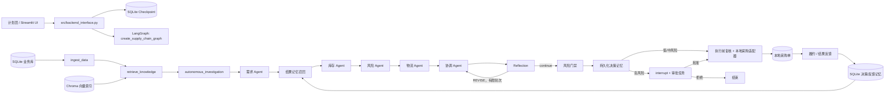

# 供应链决策助手：Agent Engineer 面试准备手册

> 依据当前仓库代码编写，面向 Agent / LLM Application Engineer 面试。本文刻意区分“已实现事实”“建议的面试表述”和“当前短板”，不要把 README、页面文案或设计目标当作实现证据。

## 1. 30 秒项目介绍

我做了一个**受治理的供应链决策 Copilot**。它读取本地库存、需求、供应商和在途数据，用确定性业务规则计算补货数量、候选供应商和风险调整成本；LLM 不直接决定采购，而是负责检索 SOP/合同/历史事件、在白名单内调用只读调查工具、生成可解释摘要并对方案做有限反思。高风险方案通过 LangGraph interrupt 暂停并持久化，人工批准后重新校验实时快照再创建本地模拟采购单，随后可以录入履约和结果反馈，沉淀为可召回的结果记忆。

**一句定位**：不是“让 LLM 自由下单”，而是“把 LLM 放进可审计、可约束、可恢复的供应链决策闭环”。

## 2. 项目背景和目标

### 为什么做这个项目

供应链补货不是单一表单计算：计划人员要同时理解需求波动、库存位置、在途供给、供应商交期/质量、运输风险，以及合同/SOP/历史异常。纯 Dashboard 会把这些信息交给人手工整合；纯聊天机器人又可能幻觉出供应商、数量或合同条款。

项目目标是把“数据读取 → 规则决策 → 企业知识证据 → 风险治理 → 人工审批 → 履约反馈”连接为一条可演示、可审计的本地闭环。

### 解决什么问题

- 让补货建议能说明：**为什么现在补、补多少、向谁补、风险在哪里、依据什么制度**。
- 把非结构化 SOP、合同和历史事件与实时结构化供应链数据联合使用。
- 对有资金承诺/供应风险的方案设置门禁，避免 LLM 直接产生写操作。
- 让审批后的执行不会基于陈旧库存；让实际结果有机会成为后续决策经验。

### 为什么需要 Agent，而不是普通应用

面试时应给出平衡回答：

**不需要 Agent 的部分**：需求预测、补货数量、供应商候选、风险分数、审批阈值与执行校验都应该是确定性代码，普通 Python service 完全能完成，且更可测试。

**适合 LLM/Agent 的部分**：

1. 在不同场景下选择哪几项调查（库存、在途、供应商、知识、压力测试）更有信息价值；
2. 将实时数据和多份非结构化证据整理为适合管理者理解的解释；
3. 作为独立 critic 检查解释、证据覆盖和异常是否被忽略；
4. 在不赋予写权限的前提下适配长尾业务问题。

因此，这不是必须“多 Agent 化”的传统 CRUD 系统，而是一个**确定性核心 + 有界 LLM 推理层**的工作流。若业务场景固定且无非结构化知识/解释需求，普通 workflow 会更简单；LangGraph 在这里的主要必要性是审批 interrupt、状态持久化和可恢复路由，而不是炫技。

## 3. 当前真实架构

### 调用与数据流证据

| 层 | 真实代码 | 作用 |
|---|---|---|
| UI | `ui/app.py` | 四个工作区：决策、审批、结果反馈、决策档案 |
| UI 后端边界 | `src/backend_interface.py` | `run_one_cycle`、`review_decision`、采购状态流转、反馈入口 |
| 工作流 | `src/graph.py:create_supply_chain_graph` | 固定节点图、反思回路、审批分支 |
| State | `src/state.py:SupplyChainState` | product、run id、快照、RAG、Agent 输出、风险、审批、反思、记忆 |
| 实时业务数据 | `src/db_service.py`、`src/models.py` | SQLite 读写及模型 |
| 决策核心 | `src/business_rules.py` | 可复算预测与补货方案 |
| LLM | `src/llm_config.py`、`src/agents/` | 结构化解释、工具选择、反思 |
| RAG | `src/rag/`、`src/nodes/knowledge_retrieval.py` | 离线入库和在线检索 |
| 安全执行 | `src/nodes/decision_gate.py`、`execution.py`、`approval_policy.py` | 门禁、重校验、审批授权、幂等 |
| 记忆与反馈 | `src/nodes/long_term_memory.py`、`src/memory_rules.py` | 决策记忆写入、结果验证后的召回 |

### 工作流逐步解释

`src/graph.py` 中的顺序不是 LLM 动态编排，而是代码明确规定：

`ingest_data → retrieve_knowledge → autonomous_investigation → demand_agent → recall_memory → inventory_agent → [risk_agent || logistics_agent] → coordinator → reflection → decision_gate → persist_memory → execute / human_approval`。风险与物流只依赖同一份库存计划，分别写入不同的 `agent_outputs` key，因此使用 fan-out/fan-in 并行；协调节点等待两者完成后只执行一次。工具调查与需求分析仍保持顺序。

其中只有 reflection 有条件回边（`REVISE → coordinator`），审批有条件恢复；`create_continuous_monitoring_graph` 虽存在，但当前 UI/主入口没有使用它，不应作为已上线的持续监控能力介绍。

## 4. 核心技术亮点（可讲、可验证）

### 4.1 规则主导、LLM 辅助的决策边界

**证据**：`src/agents/demand_agent.py:demand_agent_node` 先调用 `calculate_supply_chain_plan`；`src/agents/coordinator_agent.py:coordinator_agent_node` 将 `inventory` 已计算的 action、supplier、quantity、expedite 原样写入 `final_decision`；`src/nodes/execution.py:validate_final_decision` 再与实时规则计算结果比对。

**亮点表述**：我没有让模型输出的 JSON 直接成为采购指令。模型可以解释与审查，但写操作前必须满足：动作与实时规则一致、供应商合格、数量一致、HOLD 不带采购字段。

**价值**：可防止“应采购 20 件却 hallucination 成 2000 件”直接落库。

### 4.2 真正有约束的自主工具调用

**证据**：`src/autonomous_tools.py:build_read_only_tools` 仅构建 6 个只读工具；参数是 Pydantic model（`extra="forbid"`、范围限制）；`src/agents/tool_investigator.py:autonomous_tool_investigation_node` 做 allowlist、调用次数上限、超时、缓存、结果 schema 校验和审计 trace。

**工具清单**：库存位置、需求预测、在途采购、供应商比较、企业知识搜索、压力测试。

**亮点表述**：工具调用不是 `eval` 或任意函数映射；模型只能选 state-bound 的只读工具，无法创建采购单、改数据库或批准决策。采购写操作位于后续独立执行节点。

### 4.3 有证据治理的 RAG

**证据**：`src/rag/ingest.py` 负责文档切分/embedding/Chroma 持久化；`src/rag/retriever.py:retrieve_knowledge_for_snapshot` 先做 Chroma 召回，再按 `status=active`、相似度阈值、产品/供应商/区域和有效期过滤；`format_retrieved_context` 将来源、版本、有效期、分数和片段传入 Agent。

**亮点表述**：这里不是关键词 grep。知识索引和运行时查询分离，运行时只读已发布索引；每个 Agent 有自己的查询意图和偏好文档类型，页面保留引用来源。

**诚实边界**：没有独立 reranker、权限隔离或知识审核后台；metadata 质量直接影响检索正确性。

### 4.4 持久化 Human-in-the-loop，而非按钮式审批

**证据**：`src/nodes/human_approval.py:human_approval_node` 调用 `langgraph.types.interrupt`；`src/backend_interface.py:_invoke_durable_graph` 使用 `AsyncSqliteSaver`；`review_decision` 使用 `Command(resume=...)` 恢复同一 thread id；`execution_node` 在写入前调用 `assert_approval_authorizes_execution`。

**亮点表述**：流程暂停时已经创建审批任务和决策记忆，但尚未创建采购单；批准后不是“把 UI 状态改成已批准”，而是从 durable checkpoint 恢复，并根据最新快照重做授权和决策校验。

### 4.5 有限、可失败关闭的反思回路

**证据**：`src/agents/reflection_agent.py:reflection_agent_node` 对 coordinator 输出做 LLM review 和 `deterministic_reflection_checks`；`src/reflection_rules.py` 限制最大轮数；`src/graph.py` 只允许 `reflection → coordinator` 的有界回路。反思 LLM 异常被转为需要升级的风险信号。

**亮点表述**：反思不是无穷“再问模型一次”。它有独立 prompt、确定性检查、记录历史、最大轮次和 fail-closed 升级策略。

### 4.6 结果验证后的长期业务记忆

**证据**：`src/nodes/long_term_memory.py:persist_decision_memory_node` 在执行/审批前写决策；`recall_long_term_memory_node` 按产品、动作、供应商和需求波动召回；`src/db_service.py:record_outcome_feedback`（配合 UI 反馈表单）记录结果后才形成 outcome-verified 经验候选。

**亮点表述**：不把随便一段对话当长期记忆。记忆与决策、采购单和实际结果关联，重点召回已获得结果验证的案例。

### 4.7 执行安全：幂等、重校验与可观测

**证据**：`execution.py:build_decision_key` 基于 workflow run、产品和方案生成键；`ProcurementAdapter.create_order` 接收 `decision_key`；`execution_node` 重新调用 `read_supply_chain_snapshot` 与 `calculate_supply_chain_plan`；`src/observability.py` / `AGENT_TRACE_PATH` 记录工作流、工具与失败事件。

**亮点表述**：批准不是永久通行证。库存变化后旧方案会 stale；同一运行重试通过 decision key 避免重复创建本地采购单。

## 5. 深挖关键代码实现

### A. 图与状态：`src/graph.py`、`src/state.py`

**关键函数/类型**：`create_supply_chain_graph(checkpointer=None)`、`SupplyChainState`、`merge_agent_outputs`。

**设计思想**：把跨节点的数据显式放在 TypedDict 中。`db_snapshot`/RAG/Memory 采用替换 reducer，`agent_outputs` 采用 merge reducer，避免不同角色节点随意覆盖其他输出。`workflow_run_id` 在整个 run 中稳定，是审批检查点和写入幂等的关联键。

**可能问题**：State 内部仍以大量嵌套 `dict` 表示，跨节点字段拼写和语义不如 Pydantic state model 严格；图的专家节点是固定串行，无法证明存在 LLM supervisor 动态任务拆解或冲突协调。面试中应主动说“多职责流水线”，不要说“动态多 Agent 协商”。

### B. 实时输入边界：`src/nodes/data_ingestion.py`、`src/db_service.py`

**关键函数**：`data_ingestion_node`（读取快照）、`read_supply_chain_snapshot`。

**设计思想**：先形成同一份结构化业务快照，再让下游 Agent 和工具在该快照上推理，降低节点各自读库导致的不一致。

**可能问题**：系统仍是本地 SQLite、单机场景，没有 ERP/WMS/SRM/TMS 实时集成、事件驱动或并发库存锁。执行时虽重读快照，但不等于分布式事务。

### C. RAG：`src/rag/ingest.py`、`src/rag/retriever.py`、`src/nodes/knowledge_retrieval.py`

**关键函数**：`retrieve_knowledge_for_snapshot`、`search_enterprise_knowledge`、`_is_applicable`。

**设计思想**：离线发布索引，线上仅读；按 agent intent 构造查询，先向量召回再做 metadata/适用性过滤，并向 prompt 提供可引用的片段，而不是整个文档。

**可能问题**：没有 rerank 模型和检索质量线上监控；`top_k=3`、阈值/偏好加权为手工参数；文档中 metadata 可能缺失或被错误标注。面试要准备离线 retrieval eval（`src/evaluation/retrieval_evaluator.py`、`evals/retrieval_cases.json`）的结果，而不是只说“用了 Chroma”。

### D. 工具层：`src/autonomous_tools.py`、`src/agents/tool_investigator.py`

**关键函数**：`build_read_only_tools`、`autonomous_tool_investigation_node`、`validate_tool_response`。

**设计思想**：工具与本轮快照绑定、只读、参数最小权限化。Agent 循环最多请求 5 次模型响应，工具总数还受环境变量/hard cap 约束；同参数调用用缓存复用；错误不使整个流程必然中止，而是留下 degraded trace。

**可能问题**：所有工具仍是进程内 Python 函数而非真实外部 API，timeout 主要防本地调用；没有权限按用户/租户细分；cached knowledge fallback 在 live vector search 失败时可能退化为对已召回片段排序，不能替代真正语义检索。

### E. 决策与协调：`src/business_rules.py`、`src/agents/*_agent.py`

**关键函数**：`calculate_supply_chain_plan`、`demand_agent_node`、`inventory_agent_node`、`risk_agent_node`、`logistics_agent_node`、`coordinator_agent_node`。

**设计思想**：数值计划先算好，各 Agent 使用不同上下文给解释，coordinator 只发布已算结果。`validate_coordinator_proposal` 也保留了对动作、供应商、数量和加急字段的一致性检查思路。

**可能问题**：专家 Agent 的主要差异是 prompt/解释，而非拥有独立目标、记忆、状态权限和异步协作；真实业务的需求模型、成本模型、供应商约束仍较简化。不要宣称“多 Agent 共同投票产出最优解”。

### F. 反思：`src/agents/reflection_agent.py`、`src/reflection_rules.py`

**关键函数**：`reflection_agent_node`、`determine_reflection_outcome`、`deterministic_reflection_checks`。

**设计思想**：critic 不改数量/供应商，而是检查解释是否覆盖风险、工具告警、证据和历史经验；若确需修订，只把反馈给 coordinator；轮数到上限或 LLM 失效时升级而非放行。

**可能问题**：反思不能寻找替代决策，只能改善解释/升级；revision 后 coordinator 仍从同一确定性计划生成，因此业务“改方案”空间很小。正确说法是“解释与风险审计反思”，不是“自我优化采购策略”。

### G. 审批、恢复与执行：`src/nodes/human_approval.py`、`src/backend_interface.py`、`src/nodes/execution.py`

**关键函数**：`human_approval_node`、`review_decision`、`execution_node`、`validate_execution_authority`、`validate_final_decision`。

**设计思想**：审批记录、决策哈希、角色、状态和 checkpoint thread id 关联。恢复 payload 由 `ApprovalResumeInput` 校验；执行节点再校验审批授权与实时计划；写入使用 decision key。

**可能问题**：审批人由 `.env` 的本地邮箱/角色模拟，没有 SSO、组织架构、通知、权限审计或真实分离职责证明。SQLite checkpointer 可演示重启恢复，不适合高并发生产环境。

### H. 记忆与反馈：`src/nodes/long_term_memory.py`、`src/memory_rules.py`、`src/db_service.py`、`ui/app.py`

**关键函数**：`persist_decision_memory_node`、`recall_long_term_memory_node`、`record_outcome_feedback`。

**设计思想**：先持久化决策以保持审计关联；反馈必须在 UI 录入实际交期/数量/成本/服务等结果后，成为 outcome-verified memory。召回使用业务上下文而不是聊天历史。

**可能问题**：记忆是 SQL 查询/规则排序，不是向量化的语义经验库；没有自动纠错、过期策略、人工审核、反事实评估或多用户隔离。它是“持久化结果案例记忆”，不应夸称“自主学习”。

## 6. 面试时推荐的 Demo 讲法

1. 选“专用件 C（高缺货风险）”，先展示实时库存、需求、在途和知识证据。
2. 点击生成方案，解释 Agent 读了哪些信息、哪些数字由规则产生、工具为何只读。
3. 展开运行记录：展示知识来源、工具 trace、反思结论和风险分数。
4. 若进入审批，打开审批任务，强调 interrupt/checkpoint/resume，而非仅页面弹窗。
5. 批准后展示执行前重校验与本地采购单创建。
6. 在“结果反馈”推进采购单状态，录入结果，说明只有结果已验证的案例才有机会被未来方案召回。

不要在现场依赖不稳定的免费模型额度。准备静态 Demo 作为 UI 兜底，但必须明确其不运行真实 Agent/RAG/审批。

## 7. Agent 岗位高频面试问题

下面问题按“可回答”和“高风险追问”标记。括号内为建议回答方向，而非背诵稿。

### 7.1 架构与必要性

1. **为什么不是普通补货系统？**【可回答】规则决策确实可普通化；Agent 价值在异构证据检索、按场景选择只读调查、解释和审计。
2. **为什么不是单 Agent？**【部分可回答】不同解释/检查职责拆开便于 prompt、trace、测试与最小权限；但当前没有动态协商，承认固定图更准确。
3. **谁负责路由和任务拆解？**【可回答】代码固定路由，`graph.py`；不是 LLM supervisor。风险/反思分支由规则函数决定。
4. **为什么需要 LangGraph？**【可回答】核心是 durable checkpoint、interrupt/resume、状态图与有限回路；普通 Python pipeline 难以干净实现跨进程审批恢复。
5. **如果去掉 LLM，系统还能做什么？**【可回答】规则预测、补货、门禁、采购模拟、履约与反馈仍可运行；失去知识语义检索、解释、动态只读调查和语言反思。
6. **连续监控图是否已上线？**【高风险】没有。`create_continuous_monitoring_graph` 未被 UI/main 调用，不能宣传为已启用监控。

### 7.2 Agent、Tool 与 Guardrail

7. **模型到底能决定什么？**【可回答】解释、工具选择和 critic verdict；不能修改最终采购动作、数量、供应商或写数据库。
8. **怎样防止模型采购 2000 件？**【可回答】coordinator 固定使用规则值；`validate_final_decision` 用实时规则复算并比对；写节点不暴露为 Tool。
9. **有哪些工具？如何分类？**【可回答】6 个只读进程内工具；没有 LLM 可调用写工具。采购写入为执行节点的代码动作。
10. **工具参数怎么校验？**【可回答】Pydantic `extra=forbid` + 参数范围，执行结果再由 `validate_tool_response` 校验。
11. **工具超时或异常怎么办？**【可回答】`asyncio.wait_for`、单工具错误 trace、流程调查节点降级；但不是完整的分布式 retry/circuit breaker。
12. **怎样防 Prompt Injection？**【部分可回答】工具 allowlist、只读、schema 与执行分离降低 tool injection 风险；知识文本仍可能影响 LLM 解释，没有完整 injection classifier/内容隔离。
13. **是否有幂等？**【可回答】有 run-based decision key，采购创建与决策日志用它去重；需承认跨外部 ERP 的幂等语义尚未实现。

### 7.3 RAG 与知识治理

14. **RAG 是真向量检索还是关键词搜索？**【可回答】主路径是 Chroma semantic search + embedding；随后 metadata 过滤和轻量偏好加权。仅在工具实时检索失败时可回退为已召回缓存排序。
15. **怎么保证合同正确且适用？**【部分可回答】status、版本、有效期、产品/供应商/区域过滤；但文档治理和人工审核需要外部流程，系统无法保证原文正确。
16. **为什么离线构建索引？**【可回答】避免在线请求触发昂贵/不可控的构建，确保查询只使用已发布索引；代价是新增文档要手动 ingest。
17. **如何评估 RAG？**【部分可回答】有 `evals/retrieval_cases.json` 和 `src/evaluation/retrieval_evaluator.py`；面试前应跑出实际 recall/precision 样本与失败案例。
18. **为什么没有 reranker？**【高风险】当前规模小且个人项目控制复杂度；下一步可先加小型 cross-encoder/LLM judge 对候选片段做离线对比，而非盲目上复杂基础设施。

### 7.4 Reflection、Memory 与 Evaluation

19. **Reflection 是否只是再调用一次模型？**【可回答】不是：独立 critic prompt + deterministic checks + 有界回路 + 超限/故障升级。边界是它主要改解释/升级，不能优化规则决策本身。
20. **长期记忆存在什么地方？**【可回答】SQLite 的决策/反馈数据；不是 `session_state`。结果验证后才更有资格被召回。
21. **如何避免错误记忆污染？**【部分可回答】要求实际结果反馈、白名单用户、限制召回数；仍缺少审核、过期、异常检测和经验质量评分。
22. **有离线/在线 Eval 吗？**【部分可回答】有场景/检索离线评测代码与阈值配置；没有生产在线评测、A/B 测试、自动告警 dashboard。
23. **怎么评估 Agent 成功？**【高风险】当前可用规则正确性、风险门禁、审批/执行状态、检索命中等维度；需要补充真实 baseline、人工标注和端到端任务成功率数据。

### 7.5 HITL、可靠性与生产化

24. **审批如何恢复？服务重启后还行吗？**【可回答】审批请求和 SQLite checkpoint 持久化，`Command(resume)` 以原 thread id 继续；本地重启后可读取。
25. **批准后库存变化怎么办？**【可回答】execution 节点重读 snapshot 并复算；审批授权还绑定决策哈希和实时条件，变化则阻断。
26. **人工可以修改方案吗？**【可回答】当前不支持原任务内改量再批；应拒绝/阻断后重新生成，以保留审计边界。
27. **有没有真实 RBAC？**【高风险】没有。当前是服务端 `.env` 模拟 identity/role，不能当生产权限系统宣传。
28. **如何观测模型成本、token 和延迟？**【部分可回答】本地 JSONL 有流程/工具/错误事件，可选 LangSmith；当前没有完整 token/cost 指标面板。
29. **如何部署到生产？**【高风险】目前没有 Docker、API 服务、队列、外部 DB、secret manager、CI/CD。可以讲目标方向，不能说已完成。
30. **并发执行两个同一产品方案会怎样？**【高风险】单机 SQLite + 执行前复核能降低陈旧执行，但没有库存 reservation/分布式锁/事务编排，不能保证生产并发正确性。
31. **API 超时/模型不可用时，安全策略是什么？**【部分可回答】工具调查可降级；反思失败会升级审批；但需求/协调等 LLM 失败可能使整轮失败，缺少完整 fallback provider/retry。
32. **数据隐私如何处理？**【部分可回答】本地 trace 不存完整 prompt，RAG/DB 本地保存；若调用外部模型，仍需企业级脱敏、DLP、区域和供应商合规设计。

## 8. 面试前最值得补强的 5 项

1. **跑并记录 Eval 结果**：对 `src/evaluation/runner.py` 和 retrieval evaluator 产出可展示报告，补 5~10 个失败案例和修复依据。
2. **补一个 LLM 失败降级策略**：至少对需求/协调解释模型失败提供确定性解释模板，保证关键工作流可用。
3. **完善可观测性**：记录每节点 latency、模型、输入/输出摘要、token/cost（注意脱敏），在 UI 或报告中展示一个 run trace。
4. **把生产边界写清**：在项目介绍/Demo 中主动说本地采购适配器、环境变量身份、SQLite 的限制，避免被认为堆概念。
5. **准备一次可复现 Demo**：预先构建向量索引、准备有额度的模型或录制运行结果；高风险案例演示批准、重校验、幂等和反馈。

## 9. 面试回答禁区

- 不要说“LLM 决定补货数量/供应商”；真实实现是规则决定。
- 不要说“LLM Supervisor 动态调度多 Agent”；真实实现是固定 LangGraph 图。
- 不要说“已接入 ERP / 真实采购系统”；真实实现是本地 `ProcurementAdapter`。
- 不要说“企业级 RBAC / SSO”；真实实现是 `.env` 模拟身份。
- 不要说“持续自主监控已运行”；continuous graph 目前未接入主入口。
- 不要把静态 `demo/demo.py` 中展示的 RAG/风险当作实时运行结果。

## 10. 最终面试定位

这是一个**较完整的 Agent 学习/面试项目**：强项是把 LLM 放在明确的安全边界内，并实现了向量 RAG、受限 Tool Calling、有限反思、耐久 HITL、结果反馈和本地幂等执行的端到端链路。

它还不是生产级 Agent 系统，也不是动态协商型 Multi-Agent。最好的面试策略不是堆术语，而是展示工程判断：哪些任务必须确定性、为什么给 LLM 最小权限、怎样避免审批后陈旧执行、怎样让非结构化知识和结果反馈可追溯地参与决策。
